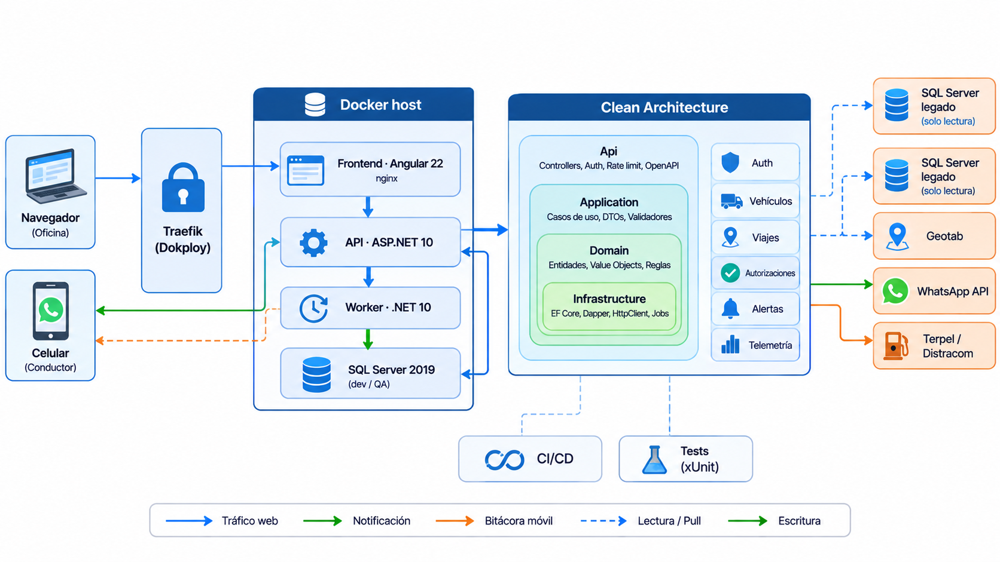

# Arquitectura de SMARTANK

## 1. Descripcion

SMARTANK gobierna el tanqueo de una flota de camiones de extremo a extremo: decidir donde y cuanto tanquear, controlar la
autorizacion, ejecutar la orden con el conductor y verificar la carga contra la telemetria del vehiculo.

Objetivos del sistema:

- Recomendar la estacion de servicio (EDS) mas barata sobre la ruta real del viaje y fijar galones maximos y precio techo.
- Autorizar el tanqueo (Despacho), notificar al conductor por WhatsApp y recibir su reporte (foto del surtidor y odometro).
- Verificar la carga contra el nivel de tanque (Geotab) y generar alertas de desviacion para Control de Flota.
- Medir la recuperacion de margen (tablero para Finanzas).
- Dejar trazabilidad de toda accion que cambia estado en una bitacora de auditoria append-only.

## 2. Vista general



| Componente | Tecnologia | Responsabilidad |
|---|---|---|
| Frontend | Angular 22 (SPA) servido por nginx | Interfaz de Despacho, Control de Flota, Finanzas y Admin; bitacora movil del conductor |
| API | ASP.NET 10 | Reglas de negocio, autenticacion, endpoints REST bajo `/api` |
| Worker | .NET 10 (Worker Service) | Sincronizaciones programadas contra el SQL Server legado y Geotab |
| Base de datos de la app | SQL Server 2019 | Datos propios de SMARTANK (esquema en `Database/ddl.sql`) |
| Fuentes legadas | SQL Server (solo lectura) | Maestros de flota, viajes, tanqueos, rutas y cierre de viajes |
| Integraciones | Geotab (JSON-RPC), API de WhatsApp (HTTP) | Telemetria y notificacion al conductor |

## 3. Arquitectura del backend: Clean Architecture de 4 capas

```
Smartank.Api            Controllers, autenticacion, middlewares, CORS, rate limiting, OpenAPI
Smartank.Application    Casos de uso (Commands/Queries + handlers), DTOs, validadores, puertos
Smartank.Domain         Entidades, enums, reglas puras (autonomia, geometria), value objects
Smartank.Infrastructure EF Core + SQL Server, Dapper (legado), clientes HTTP, hash, tokens
Smartank.Worker         Segundo punto de entrada: tareas programadas (reusa Application + Infrastructure)
```

Regla de dependencias (siempre hacia adentro):

```
Api ----------> Application ----------> Domain
 |                  ^                      ^
 +--> Infrastructure +----------------------+
      (implementa los puertos de Application)
Worker ---> Application, Infrastructure
```

- **Domain** no depende de nada. Contiene las reglas que no dependen de tecnologia.
- **Application** depende solo de Domain. Define los puertos (`I...Repository`, `I...Port`) que Infrastructure implementa.
- **Infrastructure** implementa los puertos y es la unica capa que conoce EF Core, Dapper, HTTP y los proveedores externos.
- **Api** referencia Infrastructure unicamente como composition root (inyeccion de dependencias en `clsProgram.cs`); los
  controllers solo usan tipos de Application.
- **Worker** es un host adicional, no una capa nueva: no tiene logica propia.

### Casos de uso sin mediador

Cada operacion es un `Command` (escribe) o una `Query` (lee) con su handler. El controller inyecta el handler concreto
(`ICommandHandler<,>` / `IQueryHandler<,>`). No se usa MediatR ni bus: es una organizacion por caso de uso, no una
separacion fisica de modelos de lectura y escritura.

### Monolito modular

Cada modulo agrupa sus carpetas en las cuatro capas (por grupo funcional, no por tipo tecnico):

| Modulo | Responsabilidad |
|---|---|
| Auth / Usuarios | Inicio y cierre de sesion, sesion actual, roles, administrador inicial |
| Vehiculos | Maestro de flota y ultima telemetria (nivel de tanque, ubicacion, odometro) |
| Conductores | Maestro de conductores y celular para la notificacion |
| Estaciones | Catalogo de EDS con coordenadas y precios por producto |
| Viajes y Rutas | Fletes sincronizados, estado del viaje y polilinea de ruta |
| Autonomia y Recomendacion | Calculo de autonomia y seleccion de la EDS sobre la ruta |
| Autorizaciones | Ciclo de vida de la autorizacion, preautorizacion con la EDS y notificacion al conductor |
| Bitacora y Eventos | Reporte del conductor con token firmado, fotos y verificacion de la carga |
| Alertas | Bandeja de alertas de desviacion y su gestion |
| Metricas | Recuperacion de margen y tablero |
| Sincronizacion | Lectura del SQL Server legado y de Geotab hacia la base propia |

## 4. Flujos principales

### 4.1 Autorizar y gobernar un tanqueo

1. Despacho abre un viaje y pide la recomendacion (`POST /api/viajes/{id}/recomendacion`).
2. El caso de uso calcula la autonomia (`nivel x rendimiento x (1 - tolerancia)`), ubica al vehiculo sobre la ruta y elige la
   EDS mas barata de ACPM dentro de la zona de repostaje (a menos de 200 m de la ruta, por delante del vehiculo y entre el
   60 % y el 100 % de la autonomia). Si la autonomia cubre la ruta restante, indica que no hace falta tanquear.
3. Se crea (o se actualiza) una autorizacion en estado `propuesta` con vigencia de 12 horas.
4. Despacho autoriza (`propuesta` -> `autorizada`) y notifica: se emite un token firmado y se envia por WhatsApp la orden con
   estacion, galones, mapa y el enlace de bitacora.
5. El conductor abre el enlace (sin cuenta), sube la foto del surtidor y registra galones y odometro.
6. La verificacion cruza lo cargado contra la autorizacion y el nivel de tanque, genera alertas y deja la autorizacion en
   `ejecutada` o `ejecutada_parcial`.
7. Cada paso queda en `tblAuditLog`.

### 4.2 Autenticacion

Login con correo y contrasena (bcrypt). La API entrega un JWT en una cookie `httpOnly` (`smartank_session`, SameSite
Strict). La SPA restaura la sesion con `GET /api/auth/me`. Los conductores no tienen cuenta: usan el token firmado de la
bitacora, de vigencia limitada y de un solo uso.

### 4.3 Sincronizacion

El Worker ejecuta dos grupos de tareas:

- **Frecuente** (cada 5 minutos por defecto): telemetria (Geotab), tanqueos (historial Terpel y Distracom), viajes y rutas
  nuevas o actualizadas.
- **Diario**: vehiculos, conductores, rutas completas, precios, precios por ruta y rendimiento.

Cada corrida es independiente: si una falla, no detiene a las demas, y no se solapan corridas del mismo grupo (tampoco entre
replicas, mediante un bloqueo de aplicacion en SQL Server).

## 5. Datos

- Base propia en SQL Server 2019. El esquema se crea una sola vez con `Database/ddl.sql` (no hay migraciones de EF Core);
  Entity Framework solo lo mapea. Detalle de tablas y columnas en [MODELO_DE_DATOS.md](MODELO_DE_DATOS.md).
- Tablas con prefijo `tbl` y nombres en PascalCase plural (`tblVehiculos`, `tblAutorizacionesTanqueo`).
- Las fuentes legadas se leen en solo lectura con Dapper, a traves de adaptadores (capa anticorrupcion) que traducen las
  columnas del legado a DTOs propios.

## 6. Decisiones de arquitectura

| Decision | Motivo |
|---|---|
| Monolito modular, sin microservicios | El sistema es de un solo equipo y dominio; la complejidad distribuida no aporta valor |
| Worker como host separado, misma solucion | Aisla las cargas de sincronizacion del trafico web sin duplicar codigo |
| Sin mediador (MediatR) ni AutoMapper | Evita dependencias con licencia comercial y capas innecesarias |
| DDL manual y EF solo como mapeo | El esquema lo administra quien aprovisiona la base; el runtime no necesita permisos de DDL |
| Contrato JSON en snake_case | Se conserva el contrato del sistema original para migrar el frontend sin rediseno |
| Bitacora con token firmado | El identificador del viaje (manifiesto) es predecible y no sirve como credencial |
| Angular detras de nginx con proxy a `/api` | Un solo origen: cookies y CORS sin configuracion especial; el API no se expone a internet |
